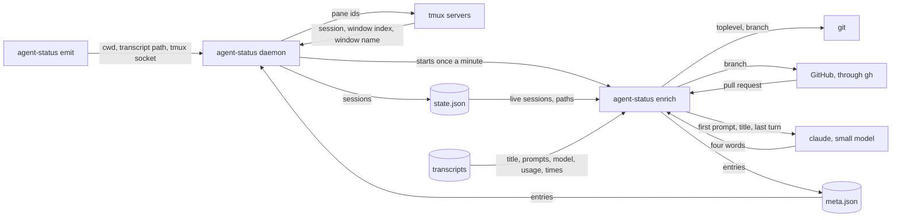

# agent-status enrich spec

## overview

How each session's record gets its place in tmux and its metadata. Emit adds the working
directory, transcript path and tmux socket to every event. The **daemon** asks each tmux server
where its panes sit, on a session's first event and once a minute, and starts the **enrich
command** once a minute. Enrich reads every live session's transcript, asks git and GitHub about
its directory and, when a turn has ended, asks the **namer** for a short name, then writes
**meta.json**. On each export the daemon copies each entry into its session in state.json.

_An arrow is data from producer to consumer; git, gh and the namer are commands enrich runs._

## building blocks

**enrich command** (job): one short process that exits; a lock in the state directory skips a
run while another holds it, and the daemon never waits on it. Each Claude reply is counted
once and priced at its own model, subagent transcripts add to their parent, and pi's own
cost is taken as written. On a repository it runs only the two read commands below; gh has
a timeout, and a failure or a branch with no pull request leaves the pull request out. The
namer gets the first prompt, title and last turn. It is asked only when the session has new turns and no
turn runs; until then, and when the call fails, the title's first words stand in. Enrich replaces meta.json whole on each run, mode 0600;
the daemon copies an entry only into a session it holds, and a missing or unreadable file
leaves every session's metadata as it was.

## contracts

| From -> to | Call | Ids | Returns | Auth |
| --- | --- | --- | --- | --- |
| enrich -> GitHub | `git rev-parse --show-toplevel --abbrev-ref HEAD`, `gh pr view <branch> --json number,state` | session directory, branch | repository, branch, pull request number and state | the user's gh login |
| enrich -> claude | the judge's model command, replaced by `AGENT_STATUS_NAMER_COMMAND` | session id | at most four words | the user's claude login |

- claude needs: hooks off and no session kept, so a naming call is never a session.

## failure modes

- **No transcript or no repository**: the entry leaves those fields out and keeps the rest; the next run tries again.
- **gh slow or failing**: the pull request is left out for that run.
- **Model not priced**: the cost is left out, never guessed.

## validation

The fixture set is the one in [agent-status-spec](agent-status-spec.md#validation).

- `readable-record` (test, [e2e tests](https://github.com/jvrsantacruz/agent-status/blob/main/cmd/agent-status/e2e_test.go)): on a scratch tmux server, a session's tmux session, window index and window name appear on its first event and survive a restart.
- `read-only` (test, [enrich e2e](https://github.com/jvrsantacruz/agent-status/blob/main/cmd/agent-status/enrich_e2e_test.go)): logging git and gh fakes record only the two read commands.
- `private-text` (test, [enrich e2e](https://github.com/jvrsantacruz/agent-status/blob/main/cmd/agent-status/enrich_e2e_test.go)): meta.json is mode 0600, the last prompt is at most 200 characters, and state.db holds no prompt, title or name.
