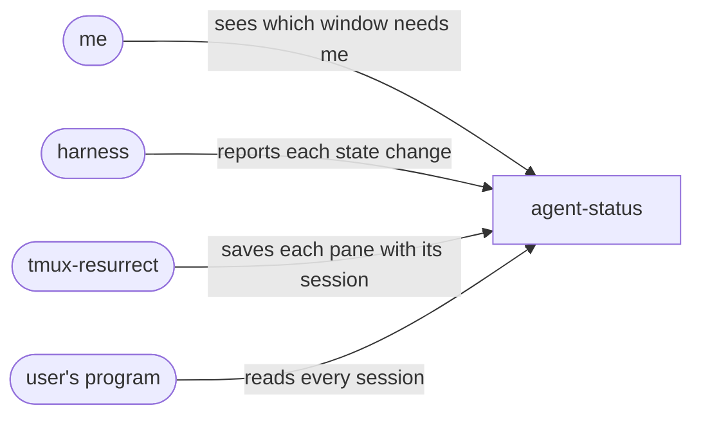

# agent-status intent

## domain

agent-status shows in the tmux window list what each AI coding agent session is doing, so
with several agents in several windows the one that needs me is visible without visiting
each window. It also knows which pane each session runs in, so, where I turn resurrect integration on, a
[tmux-resurrect](https://github.com/tmux-plugins/tmux-resurrect) restore reopens the same
Claude Code or pi conversation. It is not a notifier and sends nothing off the machine.

- **session**: one agent conversation, named by the id the agent gives it, running in one
  pane; it ends with an end event, or when its process exits and the dead keep time passes.
- **harness**: the agent program that runs a session: claude, pi, or any program that
  reports its state.
- **state**: working, question, idle, error, or dead; dead means the session's process is
  gone.

_The use cases: each arrow is an actor and the goal it has with agent-status._

## requirements

- `window-marks`: The tmux window list MUST mark each window whose active pane holds a session that is working, asking a question or in error.
- `exit-clears`: If a session's process exits without an end event, then the window whose active pane held it MUST show it dead until the dead keep time passes or a live session takes that pane.
- `restore-resumes`: Where resurrect integration is on, when tmux-resurrect restores a pane that held a live claude or pi session, the pane MUST reopen that same session.
- `readable-record`: The system MUST let any program its user runs read the harness, state and pane of every current session.

### non-functional

- `never-blocks`: If the system is down or slow, then reporting a state change MUST NOT block the harness.
- `private-text`: When reading a Claude Code hook's input, the system MUST NOT keep its prompt, tool input or error details.
- `local-only`: The system MUST NOT use the network.

### assumptions

- `resurrect-strategy`: tmux-resurrect MUST run the save command strategy named in `@resurrect-save-command-strategy` from its own strategy directory, and save what it prints as the pane's command.
