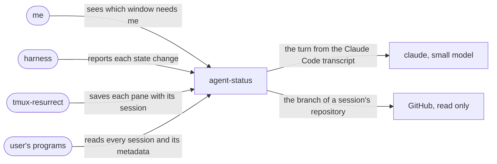

# agent-status intent

## domain

agent-status shows in the tmux window list what each AI coding agent session is doing, so
with several agents the one that needs me is visible without visiting each window. Where I turn resurrect integration on, a
[tmux-resurrect](https://github.com/tmux-plugins/tmux-resurrect) restore reopens the same
Claude Code or pi conversation in its pane. A session can declare its turn done or failed; where I turn the judge
on, a small model reads how a turn ended. Each session's record also holds its place in tmux and,
once a minute, what its transcript, directory and git say about it, for other programs to show.
It is not a notifier; only the judge, the namer and read-only GitHub calls leave the machine.

- **session**: one agent conversation, named by the id the agent gives it, running in one
  pane; it ends with an end event, or when its process exits and the dead keep time passes.
- **harness**: the agent program that runs a session: claude, pi, or any program that
  reports its state.
- **turn**: one prompt and the agent's work on it, ending when the harness stops.

_The use cases: each arrow into agent-status is an actor and its goal; the arrow out is the model the judge asks._

## requirements

- `window-marks`: The tmux window list MUST mark each window whose active pane holds a session that is working, asking a question, in error or done.
- `turn-outcome`: When a turn ends, its window MUST show until the next prompt a harness error, else the session's declared done or error, else, where the judge is on for Claude Code, a small model's reading.
- `exit-clears`: If a session's process exits without an end event, then the window whose active pane held it MUST show it dead until the dead keep time passes or a live session takes that pane.
- `restore-resumes`: Where resurrect integration is on, when tmux-resurrect restores a pane that held a live claude or pi session, the pane MUST reopen that same session.
- `readable-record`: The system MUST let any program its user runs read the harness, state, pane, tmux session and window, working directory and transcript path of every current session.
- `session-metadata`: Within a minute of a change, each session's record MUST hold its title, repository, branch, ticket, pull request, model, turns, last prompt, tokens, cost, start and last activity.
- `short-name`: Each current session's record MUST carry a name of at most four words from its intent and last turns, made again only when it has new turns and no turn runs.
- `read-only`: Gathering session metadata MUST NOT change any session, repository, pull request or tmux layout.

### non-functional

- `never-blocks`: If the system is down or slow, then reporting a state change MUST NOT block the harness.
- `private-text`: When reading a Claude Code hook's input or transcript, the system MUST NOT keep its prompt, tool input or error details, except the title, short name and a cut last prompt in its user's own files.
- `local-only`: Except the judge's and the namer's model calls and the enrich run's GitHub read calls, the system MUST NOT use the network.

### assumptions

- `resurrect-strategy`: tmux-resurrect MUST run the save command strategy named in `@resurrect-save-command-strategy` from its own strategy directory, and save what it prints as the pane's command.
