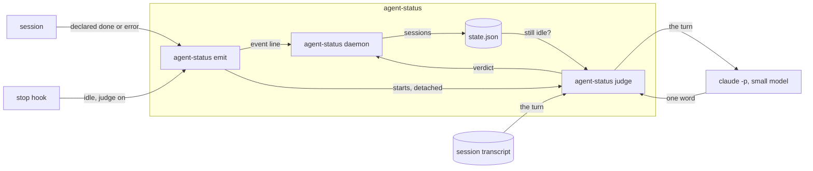

# agent-status outcome spec

## overview

How a turn's outcome reaches the window list. A session runs the **emit command** itself to
declare done or error; the daemon keeps a declared outcome through the rest of the turn and
shows it when the turn ends. Where the judge is on, the harness's stop hook runs emit with `--judge`,
which starts the **judge command** detached and returns. The judge reads the turn from the
session's transcript, asks a small model how it ended, and emits done, question or error, only
while the session is still idle from that stop.

unit: one turn.

_An arrow is data from producer to consumer._

## contracts

**session -> agent-status emit** (file, agent-status emit command line, auth none: runs as the user)
The session runs `emit done` or `emit error` with a one line summary; without `--claude-hook`
the event is declared. It needs the session id, process id and pane its harness sets in the
session's environment.
Requirements: `turn-outcome`.

**Claude Code transcript -> agent-status judge** (file, the session's JSONL transcript, auth file permissions)
The stop hook's input names the transcript. The judge reads the last prompt onward: the agent's
text, the tools it called and which failed; never tool input or output. A turn that does not
end with the agent's text is still running and is not judged.
Requirements: `turn-outcome`, `private-text`.

**agent-status judge -> claude** (file, `claude -p` command line, auth the user's Claude login)
The judge sends the turn and asks for one word; the call runs with hooks off and keeps no
session, so it never appears as a session itself. It runs outside the daemon.
Requirements: `turn-outcome`, `local-only`.

## states

| from | event | to |
| --- | --- | --- |
| working | declared done or error | that outcome, held |
| held outcome | working or question | working or question, outcome still held |
| held outcome | idle, the turn ends | the outcome |
| held outcome | harness error | error, outcome dropped |
| idle from a stop | judge verdict | done, question or error |
| any | next prompt | working |

## failure modes

- **No verdict** (the model fails, times out, or answers anything but done, question or error): the session stays idle.
- **Idle reminder** (Claude's notification a minute after a turn): emit drops it while the window shows done or error, so the outcome holds until the next prompt.
- **Verdict too late**: a new prompt or a declared outcome came first; the judge emits nothing.

## validation

The fixture set in [agent-status-spec](agent-status-spec.md) holds it.

- `turn-outcome` (test, [e2e tests](https://github.com/jvrsantacruz/agent-status/blob/main/cmd/agent-status/e2e_test.go)): a turn where the session emits done, then a tool hook and the stop, shows done with its summary over the model's verdict; with a fake model, each of done, question and error is shown as judged, idle or a failing model leave the session idle; Claude's idle reminder keeps a done or error.
