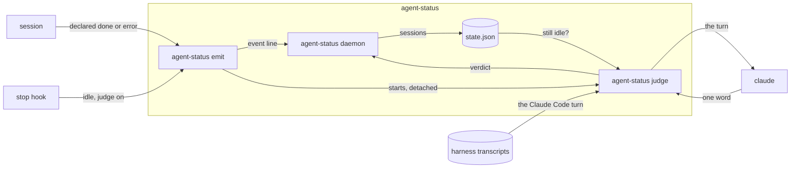

# agent-status outcome spec

## overview

How a turn's outcome reaches the window list. A session runs the **emit command** itself to
declare done or error; the daemon keeps a declared outcome through the rest of the turn and
shows it when the turn ends. Where the judge is on, Claude Code's stop hook runs emit with `--judge`,
which starts the **judge command** detached and returns. The judge reads the turn from the
session's transcript, asks a small model how it ended, and emits done, question or error, only
while the session is still idle from that stop.

_An arrow is data from producer to consumer._

## contracts

| From -> to | Call | Ids | Returns | Auth |
| --- | --- | --- | --- | --- |
| session -> agent-status emit | cli `agent-status emit done`, `agent-status emit error` | session id, process id, pane from the session's environment | none | runs as the user |
| harness transcripts -> agent-status judge | file `transcript_path`, the session's JSONL transcript | transcript named by the stop hook's input | from the last prompt: the agent's text, the tools it called and which failed | file permissions |
| agent-status judge -> claude | cli `claude -p` | none | one word | the user's Claude login |

- agent-status emit needs: a one line summary; an event without `--claude-hook` is declared.
- agent-status judge needs: a turn that ends with the agent's text, and never tool input or output; a turn that ends otherwise is still running and is not judged.
- claude needs: hooks off, no session kept, no tools and no MCP servers, so the call only reads its prompt and never appears as a session; on timeout it is asked to stop.

## states

| from | event | to |
| --- | --- | --- |
| working | declared done or error | that outcome, held |
| held outcome | working or question | working or question, outcome still held |
| held outcome | idle, the turn ends | the outcome |
| held outcome | harness error | error, outcome dropped |
| idle from a stop | judge verdict | done, question or error |
| held outcome | a prompt the harness marks | working, outcome dropped |
| any | next prompt | working |
| any outcome | Claude's idle reminder | unchanged |

## failure modes

- **No verdict** (the model fails, times out, or answers anything but done, question or error, or the transcript cannot be read): the session stays idle. A transcript line too long to read is skipped.
- **Verdict not shown**: the turn already shows a harness error or a declared outcome, a prompt arrived after the stop, or the daemon had not recorded the stop when the judge checked; the judge emits nothing and the window keeps what it shows.

## validation

The fixture set in [agent-status-spec](agent-status-spec.md) holds it.
