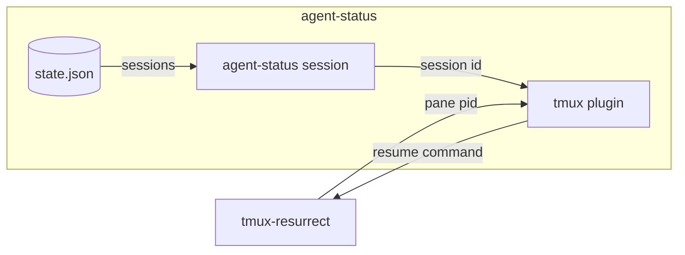

# agent-status resurrect spec

## overview

How a tmux-resurrect restore reopens the same session. With `@agent-status-resurrect` on, the
**tmux plugin** links a save strategy into resurrect's strategy directory, selects it, and adds
claude and pi to the programs resurrect replays, unless that list is `false` or `:all:`. On save,
the strategy asks the **session command** for the live session on a pane and gives resurrect its
resume command. The session command prints nothing on any error and always exits 0.

_An arrow is data from producer to consumer._

## contracts

| From -> to | Call | Ids | Returns | Auth |
| --- | --- | --- | --- | --- |
| tmux-resurrect -> tmux plugin | cli `agent-status-resurrect.sh <pane pid>`, the save command strategy | pane pid | resume command | runs as the user |

- tmux-resurrect needs: the resume command for a pane holding a live session of its program; on restore it types it when its restore list matches, and a user's inline strategy for claude or pi wins.
- tmux plugin needs: resurrect installed with TPM, to find its strategy directory (`resurrect-strategy`), and harnesses that resume by id: `claude --resume`, `pi --session`.

## failure modes

- **Plain command saved**: with state.json unreadable or no live session on the pane, resurrect saves the plain command; the restore starts a new session.
- **Resurrect left alone** (an old binary, another save strategy, resurrect not installed with TPM): the plugin warns and changes nothing.

## validation

The fixture set in [agent-status-spec](agent-status-spec.md) holds it.
