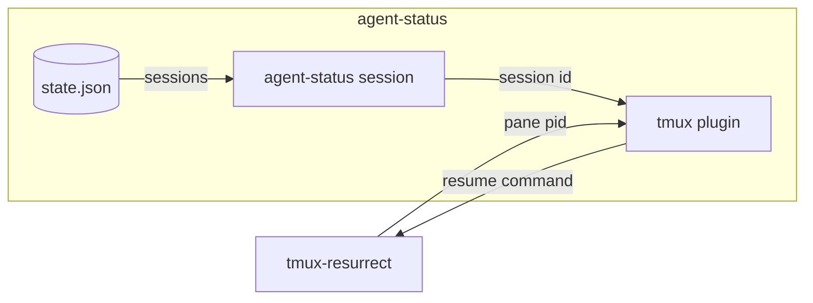

# agent-status resurrect spec

## overview

How a tmux-resurrect restore reopens the same session. With `@agent-status-resurrect` on, the
**tmux plugin** links a save strategy into resurrect's strategy directory, selects it, and adds
claude and pi to the programs resurrect replays, unless that list is `false` or `:all:`. On save,
the strategy asks the **session command** for the live session on a pane and gives resurrect its
resume command. The session command prints nothing on any error and always exits 0.

_An arrow is data from producer to consumer._

## contracts

**tmux-resurrect -> tmux plugin** (file, save command strategy, auth none: runs as the user)
On save, resurrect records what the strategy prints for a pane: the resume command when it
holds a live session of its program. On restore it types it when its restore list matches; a
user's inline strategy for claude or pi wins. The plugin needs resurrect installed with TPM,
so it can find resurrect's strategy directory (`resurrect-strategy`), and harnesses that resume by id:
`claude --resume`, `pi --session`.
Requirements: `restore-resumes`, `resurrect-strategy`.

## failure modes

- **Plain command saved**: with state.json unreadable or no live session on the pane, resurrect saves the plain command; the restore starts a new session.
- **Resurrect left alone** (an old binary, another save strategy, resurrect not installed with TPM): the plugin warns and changes nothing.

## validation

The fixture set in [agent-status-spec](agent-status-spec.md) holds it.

- `restore-resumes` (test, [resurrect-e2e](https://github.com/jvrsantacruz/agent-status/blob/main/tools/resurrect-e2e)): after a real save and restore, the pane that held a live session runs its resume command and the exited one its plain command.
