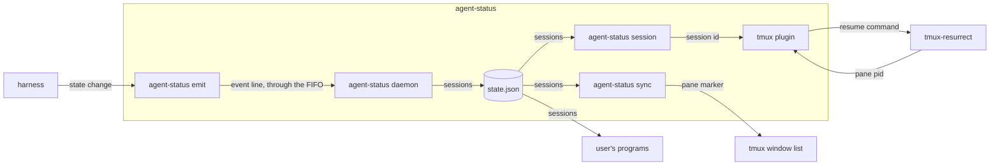
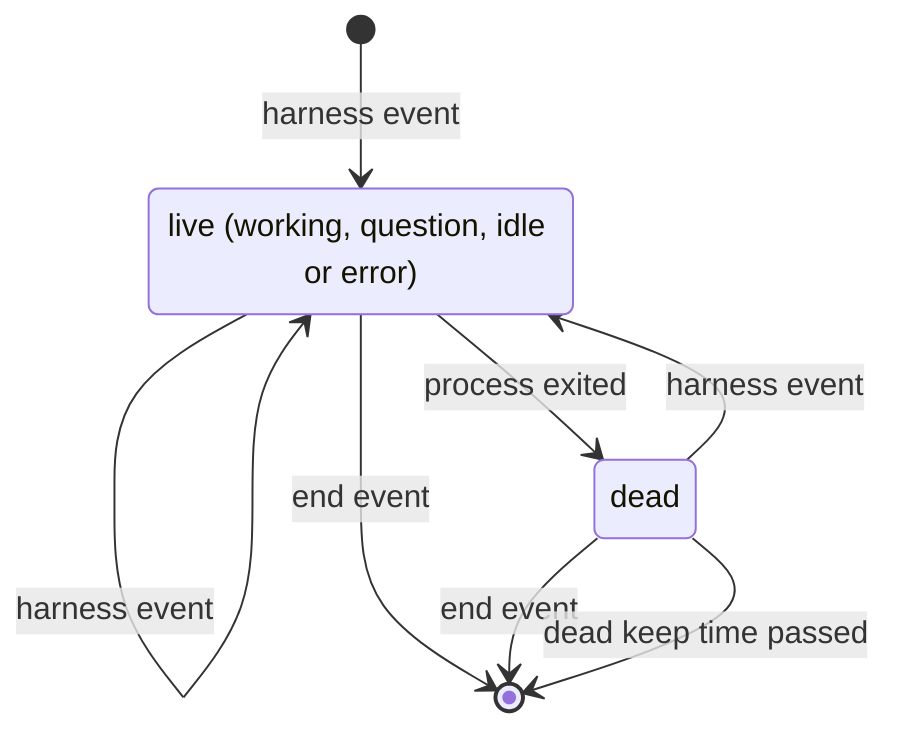

# agent-status spec

## overview

The **agent-status binary** holds every command. A harness reports each state change with the
**emit command**, which writes one line to a FIFO. The **daemon** reads it, keeps each
session's state and event history, marks a session dead when its process exits, and writes
**state.json**. In each tmux server, the **sync command** loads each pane's marker from
state.json once a second. The **tmux plugin** starts sync and, with resurrect integration on,
gives resurrect a save strategy that asks the **session command** for a pane's session id.
The **render command** prints a pane's marker for themes. The **doctor command** sends a test
session through the FIFO, waits for it in state.json, removes it and reads the history.
Neither is drawn.

unit: one agent session; every part above keeps, shows or resumes sessions.

_The containers of one machine; an arrow is data from producer to consumer._

## building blocks

**agent-status binary** (service, lives in `cmd/agent-status`): the daemon, a systemd user unit
or launchd agent, is the only writer of state.json and the history. Sync runs once per tmux
server and ends with it. The session and render commands print nothing on
any error and always exit 0.

**tmux plugin** (job, lives in `.`): defines the markers, puts the marker in the window format unless `@agent-status-auto-format` is off, and starts sync. With `@agent-status-resurrect` on, it links its save strategy into resurrect's strategy directory, selects it, and adds claude and pi to the programs resurrect replays, unless that list is `false`, where no session resumes on restore, or `:all:`.

## contracts

**harness -> agent-status emit** (file, agent-status emit command line, auth none: runs as the user)
One event per state change, from Claude Code hooks, a pi extension or any program. The harness
needs emit to exit 0 within its write timeout, except on a usage error such as no session id
or an oversized line. agent-status needs the session id, process id, tmux pane, and a harness
name equal to the program, so a restore can resume it.
[Event format](https://github.com/jvrsantacruz/agent-status#event-format).
Requirements: `never-blocks`, `private-text`, `window-marks`, `restore-resumes`.

**daemon -> the user's programs** (file, state.json, auth file permissions)
Replaced whole on each change, so no reader sees half a file. Removing or changing a field
raises the version of its
[schema](https://github.com/jvrsantacruz/agent-status/blob/main/schema/state.schema.json).
Requirements: `readable-record`.

**sync -> tmux** (ui, tmux pane options, auth tmux server socket)
Sync sets the pane option `@agent_mark` where a marker changed; the window format reads it, so
a redraw runs no command.
Requirements: `window-marks`.

**tmux-resurrect -> tmux plugin** (file, save command strategy, auth none: runs as the user)
On save, resurrect records what the strategy prints for a pane: the resume command when it
holds a live session of its program. On restore it types it when its restore list matches; a
user's inline strategy for claude or pi wins. The plugin needs resurrect installed with TPM,
so it can find resurrect's strategy directory (`resurrect-strategy`), and harnesses that resume by id:
`claude --resume`, `pi --session`.
Requirements: `restore-resumes`, `resurrect-strategy`.

## data model

| entity | stored in | key | shape | written by | kept for |
| --- | --- | --- | --- | --- | --- |
| session | state.json | session id; pane id joins a tmux pane | [state.schema.json](https://github.com/jvrsantacruz/agent-status/blob/main/schema/state.schema.json) | daemon | while live, then the dead keep time in `cmd/agent-status/daemon.go`, across restarts |
| event | state.db | row id; session id joins a session | session id, harness, event, process id, pane, sent and received time, understood; no message text | daemon | the retention in `cmd/agent-status/daemon.go` |

state.json and state.db live in the state directory, `~/.local/state/agent-status` by default;
the FIFO lives in the runtime directory, or the state directory when none is set.

## states

_Session states. A harness event moves to the state it names. Dead and removal serve `exit-clears`._

## failure modes

- **Event lost**: with no daemon or a full FIFO, emit warns and exits 0; the next event repairs the session.
- **Plain command saved**: with state.json unreadable or no live session on the pane, resurrect saves the plain command; the restore starts a new session.
- **Markers kept**: with state.json unreadable, sync keeps the markers; missing, it clears them.
- **Resurrect left alone** (an old binary, another save strategy, resurrect not installed with TPM): the plugin warns and changes nothing.
- **Session never cleared**: one without a process id stays until its end event; doctor reports it.

## validation

fixtures: [e2e tests](https://github.com/jvrsantacruz/agent-status/blob/main/cmd/agent-status/e2e_test.go) and [resurrect-e2e](https://github.com/jvrsantacruz/agent-status/blob/main/tools/resurrect-e2e): the real binary in a clean environment, fed emit calls, saved Claude Code hook inputs or written state.json files, for each state, a dead session, a restart and no daemon, plus a real save and restore on a scratch tmux server with one live and one exited session; expected outputs from hand-checked state.json, render and session values and the restored pane commands; compared exactly.

- `never-blocks` (test, [e2e tests](https://github.com/jvrsantacruz/agent-status/blob/main/cmd/agent-status/e2e_test.go)): with no daemon, or a full FIFO never read, emit exits 0 within its write timeout.
- `private-text` (test, [hook tests](https://github.com/jvrsantacruz/agent-status/blob/main/cmd/agent-status/hook_test.go)): the message kept from hook input is only the notification text, the tool name or the error type, such as rate_limit.
- `local-only` (inspection, [AGENTS.md](https://github.com/jvrsantacruz/agent-status/blob/main/AGENTS.md)): no package opens a network connection.
