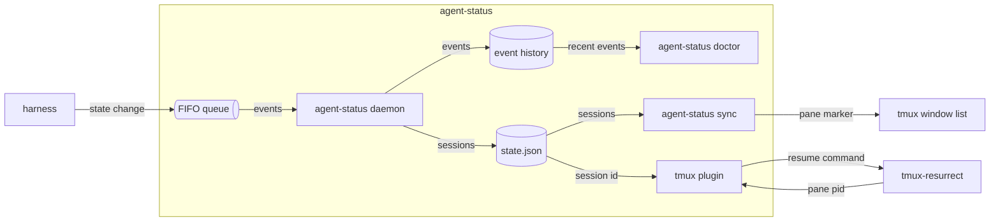
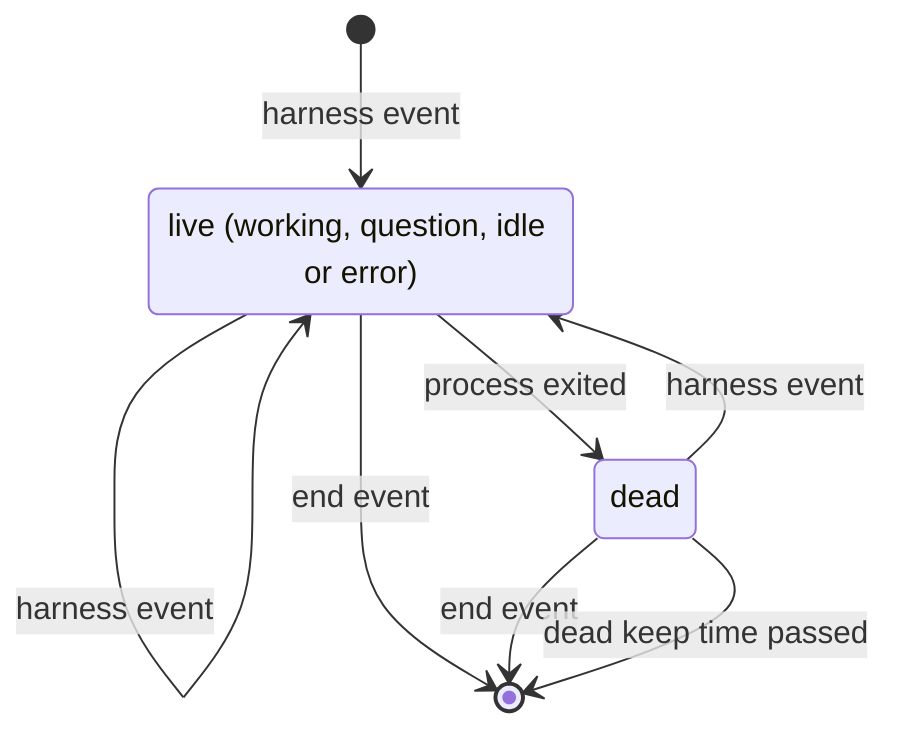

# agent-status spec

## overview

A harness reports each state change with `agent-status emit`, which writes one line to a
FIFO and returns within its write timeout. The **daemon** reads the FIFO, keeps each session's state and
event history, marks a session dead when its process exits, and writes **state.json**. In
each tmux server, **sync** loads each pane's marker from state.json once a second. The **tmux plugin** starts sync and, when resurrect integration is on, gives resurrect a save
strategy that saves an agent pane's command with its session id. **doctor** reads the history to explain a session.

unit: one agent session; every part above keeps, shows or resumes sessions.

_The containers of one machine; an arrow is data from producer to consumer._

## building blocks

**agent-status** (service, lives in `cmd/agent-status`): one binary. `daemon` runs as a
systemd user unit or a launchd agent and is the only writer of
state.json and the event history. `sync` is a loop, one per tmux server, that ends with the
server. emit exits 1 on a usage error: no state, no
session id, or fields too long for one FIFO line; on any other failure it exits 0. session
and render print nothing and never fail.

**tmux plugin** (library, lives in `.`): `agent-status.tmux` defines the markers, puts the
marker in the window format and starts sync. With `@agent-status-resurrect` on, it links
`agent-status-resurrect.sh` into resurrect's strategy directory, names it as the save command
strategy, and adds claude and pi to the programs resurrect replays.

## contracts

**harness -> agent-status emit** (file, FIFO, auth file permissions)
One event per state change, from Claude Code hooks, a pi extension or any program. The
harness needs emit to exit 0 within its write timeout; agent-status needs the process id to
tell when the session ends. Format:
[event format](https://github.com/jvrsantacruz/agent-status#event-format).
Requirements: `never-blocks`, `private-text`.

**daemon -> the user's programs** (file, state.json, auth file permissions)
Replaced whole after each change, so a reader never sees half a file. Fields are only added;
a removed or changed one raises the version of its
[schema](https://github.com/jvrsantacruz/agent-status/blob/main/schema/state.schema.json).
Requirements: `readable-record`.

**sync -> tmux** (ui, tmux pane options, auth tmux server socket)
sync sets the pane option `@agent_mark` where a marker changed; the window format reads it,
so a redraw runs no command.
Requirements: `window-marks`.

**tmux-resurrect -> tmux plugin** (file, save command strategy, auth none: runs as the user)
On save, resurrect records what the strategy prints for a pane's process id: the resume
command when the pane holds a live session of its program. On restore it types that command
when its restore list matches the program; a user's inline strategy for claude or pi
replaces it.
The plugin needs tmux-resurrect installed with TPM, since resurrect runs strategies only from
its own directory, and each harness to reopen a session from its id: `claude --resume`,
`pi --session`.
Requirements: `restore-resumes`.

## data model

| entity | stored in | key | shape | written by | kept for |
| --- | --- | --- | --- | --- | --- |
| session | state.json | session id, joined to a tmux pane by pane id | [state.schema.json](https://github.com/jvrsantacruz/agent-status/blob/main/schema/state.schema.json) | daemon | while live, then the dead keep time in `cmd/agent-status/daemon.go`, across restarts |
| event | state.db | row id, joined to a session by session id; no message text | [store.go](https://github.com/jvrsantacruz/agent-status/blob/main/internal/store/store.go) | daemon | the retention in `cmd/agent-status/daemon.go` |

## states

_Session states. A harness event moves to the state it names. Dead and removal serve `exit-clears`._

## failure modes

- **Daemon down or slow**: with no reader or a full FIFO, emit says so on stderr and exits 0; the event is lost and the next one brings the session up to date.
- **state.json unreadable**: sync skips the pass and leaves the markers as they were; session prints nothing, so resurrect saves the plain command and the restore starts a new session.
- **agent-status too old**: the plugin shows a message and leaves resurrect's strategy as it was.
- **Another save strategy set**: the plugin shows a message and leaves resurrect's strategy as it was; agent panes are saved with their plain command.
- **Session without a process id**: never marked dead, it stays until its end event; doctor reports it.
- **Pane without a live session**: an agent with no event received, or whose process exited, is saved with its plain command; the restore starts a new session.

## validation

fixtures: [e2e tests](https://github.com/jvrsantacruz/agent-status/blob/main/cmd/agent-status/e2e_test.go): the real binary runs in a clean environment, fed emit calls and saved Claude Code hook inputs, or hand-written state.json files, for every state, a dead session, a restart and a missing daemon; expected outputs from hand-checked state.json, render and session values; compared exactly.

- `restore-resumes` (demonstration, [resurrect strategy](https://github.com/jvrsantacruz/agent-status/blob/main/agent-status-resurrect.sh)): a real save and restore on a scratch tmux server types the resume command for a live session and the plain command for an exited one.
- `never-blocks` (test, [e2e tests](https://github.com/jvrsantacruz/agent-status/blob/main/cmd/agent-status/e2e_test.go)): with no daemon, and with a daemon that never reads a full FIFO, emit returns within its write timeout and exits 0.
- `private-text` (test, [hook tests](https://github.com/jvrsantacruz/agent-status/blob/main/cmd/agent-status/hook_test.go)): the message taken from hook input never carries the prompt, a tool input or error text.
- `local-only` (inspection, [AGENTS.md](https://github.com/jvrsantacruz/agent-status/blob/main/AGENTS.md)): no package opens a network connection.
