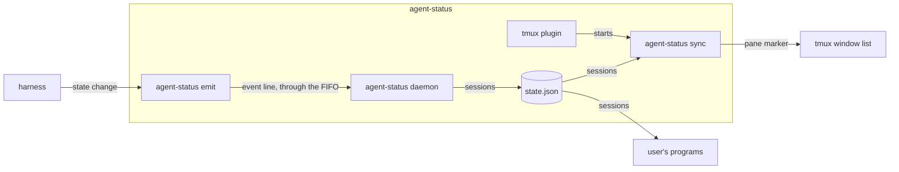
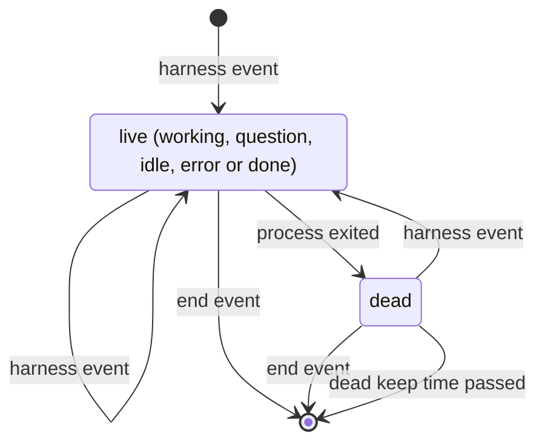

# agent-status spec

## overview

The **agent-status binary** holds every command. A harness reports each state change with the
**emit command**, which writes one line to a FIFO. The **daemon** reads it, keeps each
session's state and event history, marks a session dead when its process exits, and writes
**state.json**. In each tmux server, the **sync command** loads each pane's marker from
state.json once a second. The **tmux plugin** starts sync. The **render command** prints a
pane's marker for themes; the **doctor command** sends a test session through the FIFO. Neither is drawn. How a turn's outcome is set is in
[agent-status-outcome-spec](agent-status-outcome-spec.md); how a restore resumes a session is in
[agent-status-resurrect-spec](agent-status-resurrect-spec.md); how a session gets its place and metadata is in
[agent-status-enrich-spec](agent-status-enrich-spec.md).

unit: one agent session; every part above keeps or shows sessions.

_The containers of one machine; an arrow is data from producer to consumer._

## building blocks

**agent-status binary** (service, lives in `cmd/agent-status`): the daemon, a systemd user unit
or launchd agent, is the only writer of state.json and the history. Sync runs once per tmux
server, waits for its first session, and ends with the server. The render command prints
nothing on any error and always exits 0.

**tmux plugin** (job, lives in `.`): defines the markers, puts the marker in the window format
unless `@agent-status-auto-format` is off, and starts sync.

## contracts

**harness -> agent-status emit** (file, agent-status emit command line, auth none: runs as the user)
One event per state change, from Claude Code hooks, a pi extension or any program. The harness
needs emit to exit 0 within its write timeout, except on a usage error such as no session id
or an oversized line. agent-status needs the session id, process id, tmux pane, and a harness
name equal to the program, so a restore can resume it. Emit drops Claude's idle reminder, a
Notification of type idle_prompt, so the window keeps how the turn ended. A harness marks the
prompt that starts a turn, `--prompt` or Claude's UserPromptSubmit hook, so nothing an earlier
turn declared holds past it.
[Event format](https://github.com/jvrsantacruz/agent-status#event-format).
Requirements: `never-blocks`, `private-text`, `window-marks`, `turn-outcome`, `restore-resumes`.

**daemon -> user's programs** (file, state.json, auth file permissions)
Replaced whole on each change, so no reader sees half a file. Removing or changing a field
raises the version of its
[schema](https://github.com/jvrsantacruz/agent-status/blob/main/schema/state.schema.json).
Requirements: `readable-record`.

**sync -> tmux** (ui, tmux pane options, auth tmux server socket)
Sync sets the pane option `@agent_mark` where a marker changed; the window format reads it, so
a redraw runs no command.
Requirements: `window-marks`.

## data model

| entity | stored in | key | shape | written by | kept for |
| --- | --- | --- | --- | --- | --- |
| session | state.json | session id; pane id joins a tmux pane | [state.schema.json](https://github.com/jvrsantacruz/agent-status/blob/main/schema/state.schema.json) | daemon | while live, then the dead keep time in `cmd/agent-status/daemon.go`, across restarts |
| session metadata | meta.json | session id | [meta.schema.json](https://github.com/jvrsantacruz/agent-status/blob/main/schema/meta.schema.json) | enrich | while the session is live |
| event | state.db | row id; session id joins a session | session id, harness, event, process id, pane, sent and received time, understood; no message text | daemon | the retention in `cmd/agent-status/daemon.go` |

state.json and state.db live in the state directory, `~/.local/state/agent-status` by default;
the FIFO lives in the runtime directory, or the state directory when none is set.

## states

_Session states. A harness event moves to the state it names, except the idle that ends a turn with a declared outcome, which moves to that outcome. Dead and removal serve `exit-clears`._

## failure modes

- **Event lost**: with no daemon or a full FIFO, emit warns and exits 0; the next event repairs the session.
- **Markers kept**: with state.json unreadable, sync keeps the markers; missing, it clears them.
- **Session never cleared**: one without a process id stays until its end event; doctor reports it.

## validation

fixtures: [e2e tests](https://github.com/jvrsantacruz/agent-status/blob/main/cmd/agent-status/e2e_test.go) and [resurrect-e2e](https://github.com/jvrsantacruz/agent-status/blob/main/tools/resurrect-e2e): the real binary in a clean environment, fed emit calls, saved Claude Code hook inputs, saved transcripts or written state.json files, for each state, a dead session, a restart, no daemon, sync on a scratch tmux server started before any session, one Claude turn with a fake model command for each verdict, a declared done followed by a tool hook and the stop, by a harness error, or by an interrupted turn and a new prompt, Claude's idle reminder after each outcome, plus a real save and restore on a scratch tmux server with one live and one exited session, and for enrich saved Claude Code and pi transcripts with their text replaced, a scratch git repository on a ticket branch and fake gh and namer commands; expected outputs from hand-checked state.json, render values, pane options and the restored pane commands; compared exactly.

- `never-blocks` (test, [e2e tests](https://github.com/jvrsantacruz/agent-status/blob/main/cmd/agent-status/e2e_test.go)): with no daemon, or a full FIFO never read, emit exits 0 within its write timeout.
- `private-text` (test, [hook tests](https://github.com/jvrsantacruz/agent-status/blob/main/cmd/agent-status/hook_test.go)): the message kept from hook input is only the notification text, the tool name or the error type, such as rate_limit.
- `local-only` (inspection, [AGENTS.md](https://github.com/jvrsantacruz/agent-status/blob/main/AGENTS.md)): no package opens a network connection; the judge's and the namer's model calls are the `claude` command's, and the pull request lookup is the `gh` command's.
