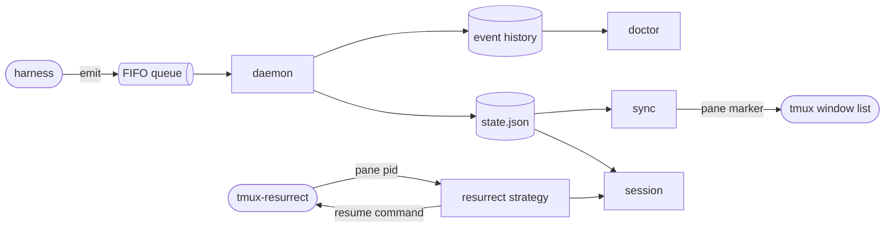

# agent-status spec

## overview

unit: one session, from its first event to its removal

A harness reports each state change with `agent-status emit`, which writes one line to a
FIFO and returns at once. The **daemon** reads the FIFO, keeps each session's state and
event history, marks a session dead when its process exits, and writes **state.json**. In
each tmux server, **sync** reads state.json once a second and sets each pane's marker
option, which the window format reads. When resurrect integration is on, the **resurrect
strategy** asks `agent-status session` which session a pane holds and saves the pane's
command with that session's id. **doctor** reads the history to explain a session; the daemon prunes it at
an age set in `cmd/agent-status/daemon.go`.

_The containers and files of one machine; an arrow is data flowing from producer to consumer._

## building blocks

**agent-status** (service, lives in `cmd/agent-status`): one binary. `daemon` runs as a
systemd user unit or a launchd agent, independent of tmux, and is the only writer of
state.json and the event history. `emit`, `sync`, `session` and `render` are short-lived
clients that never fail their caller.

**resurrect strategy** (library, lives in `.`): `agent-status-resurrect.sh`. The tmux plugin
links it into resurrect's strategy directory, because resurrect runs strategies only from
there. Every pane without a live session of its program is saved as resurrect's default
strategy saves it.

## contracts

**harness -> agent-status emit** (file, FIFO, auth file permissions)
One event per state change: session id, harness, state, process id and pane. Claude Code
calls it from hooks with the hook input on stdin, pi from an extension, any program from the
command line. The harness needs emit to return at once and exit 0; agent-status needs the
process id to tell when the session ends. Format:
[event format](https://github.com/jvrsantacruz/agent-status#event-format).
Requirements: `never-blocks`, `private-text`.

**daemon -> local programs** (file, state.json, auth file permissions)
state.json, replaced whole after each change, described by its
[schema](https://github.com/jvrsantacruz/agent-status/blob/main/schema/state.schema.json).
Readers need a complete file at every read; fields are only added, and a removed or changed
field raises the schema version.
Requirements: `readable-record`.

**sync -> tmux** (ui, tmux pane options, auth tmux server socket)
sync sets the pane option `@agent_mark` where a pane's marker changed, to a reference to the
marker option of its state, which the plugin or a theme defines. The window format reads it,
so a redraw runs no command.
Requirements: `window-marks`.

**tmux-resurrect -> resurrect strategy** (file, save command strategy, auth none: runs as the user)
On each save, resurrect calls the strategy with a pane's process id and records what it
prints as the pane's command. On restore it types that command into the rebuilt pane when
`@resurrect-processes` lists the program. The strategy prints the harness's resume command
with the session id for a pane holding a live session of that harness.
Requirements: `restore-resumes`, `resurrect-strategy`, `id-resume`.

## states

| from | event | to |
| --- | --- | --- |
| any | harness event | the event's state |
| any live state | process exited | dead, `exit-clears` |
| any | end event | removed |
| dead | dead keep time passed | removed, `exit-clears` |

## failure modes

- **Daemon not running**: emit says so on stderr and exits 0; the event is lost, and the next event after the daemon starts brings the session up to date.
- **Daemon too slow**: emit gives up when the FIFO is full, says so on stderr and exits 0; the event is lost and the next one brings the session up to date.
- **state.json unreadable**: sync skips the pass and leaves the markers as they were; session prints nothing, so resurrect saves the plain command and the restore starts a new session.
- **Pane without a live session**: an agent started before the daemon, or whose process exited, is saved with its plain command, and the restore starts a new session.

## validation

fixtures: [e2e tests](https://github.com/jvrsantacruz/agent-status/blob/main/cmd/agent-status/e2e_test.go): the real binary is built and run in a clean environment, fed emit calls and saved Claude Code hook inputs through its FIFO, or given hand-written state.json files, for every state, a dead session and a missing daemon; expected outputs from hand-checked state.json, render and session values; compared exactly.

- `restore-resumes` (demonstration, [resurrect strategy](https://github.com/jvrsantacruz/agent-status/blob/main/agent-status-resurrect.sh)): run on live panes, each pane with a live session prints its resume command and every other pane resurrect's default command.
- `never-blocks` (test, [e2e tests](https://github.com/jvrsantacruz/agent-status/blob/main/cmd/agent-status/e2e_test.go)): with no daemon, and with a daemon that never reads a full FIFO, emit returns at once and exits 0.
- `private-text` (test, [hook tests](https://github.com/jvrsantacruz/agent-status/blob/main/cmd/agent-status/hook_test.go)): the message taken from hook input never carries the prompt, a tool input or error text.
- `local-only` (inspection, [AGENTS.md](https://github.com/jvrsantacruz/agent-status/blob/main/AGENTS.md)): no package opens a network connection.
