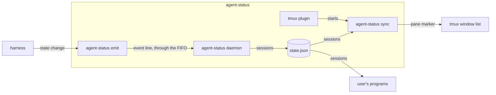
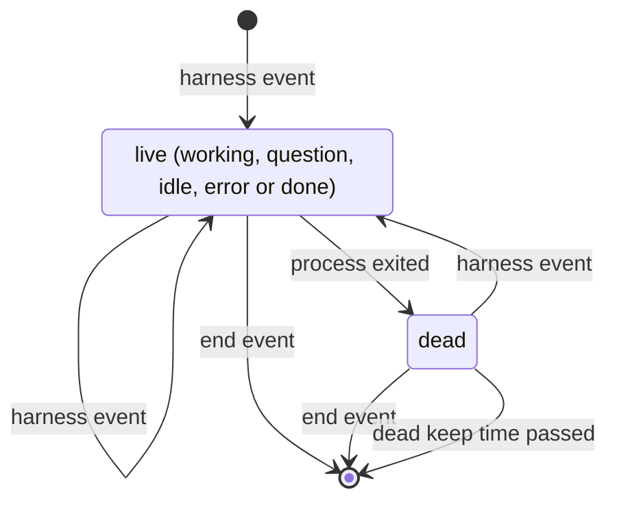

# agent-status spec

## overview

agent-status is one binary and a tmux plugin that mark each tmux window with its agent
session's state. A harness reports each state change with the **emit command**, which
writes one line to a FIFO. The **daemon** reads it, keeps each session's state, marks a
session dead when its process exits, and writes **state.json**, which the user's programs
also read. In each tmux server, the **sync command** loads each pane's marker from
state.json into tmux. The **tmux plugin** starts sync. The
[outcome](agent-status-outcome-spec.md), [resurrect](agent-status-resurrect-spec.md) and
[enrich](agent-status-enrich-spec.md) specs cover a turn's outcome, restore and metadata.

_The containers of one machine; an arrow is data from producer to consumer._

## building blocks

**agent-status binary** (service): the daemon, a systemd user unit
or launchd agent, is the only writer of state.json and the history. Sync runs once per tmux
server, waits for its first session, and ends with the server. The render command prints
a pane's marker for themes, nothing on any error, and always exits 0. The doctor command
sends a test session through the FIFO and warns when meta.json is stale. Under a service
manager's short PATH, the daemon also looks for tmux, gh and claude where they install.

**tmux plugin** (job): defines the markers, puts the marker in the window format
unless `@agent-status-auto-format` is off, and starts sync.

## contracts

| From -> to | Call | Ids | Returns | Auth |
| --- | --- | --- | --- | --- |
| harness -> agent-status emit | cli `agent-status emit` | session id, process id, tmux pane, harness | exit code | runs as the user |
| daemon -> user's programs | file `state.json` | session id | sessions | file permissions |
| sync -> tmux | cli `tmux set-option -p @agent_mark` | tmux pane | none | tmux server socket |

- harness needs: exit 0 within its write timeout, except on a usage error such as no session id or an oversized line.
- agent-status emit needs: events in the [event format](https://github.com/jvrsantacruz/agent-status#event-format), a harness name equal to the program, and each turn's start marked by `--prompt` or Claude's UserPromptSubmit hook, so nothing an earlier turn declared holds past it.
- user's programs need: a whole file on every read, and a new [schema](https://github.com/jvrsantacruz/agent-status/blob/main/schema/state.schema.json) version when a field is removed or changed.
- tmux needs: the option set only where a marker changed, so a redraw runs no command.

## data model

| entity | stored in | key | shape | written by | kept for |
| --- | --- | --- | --- | --- | --- |
| session | state.json | session id; pane id and tmux socket join a tmux pane | [state.schema.json](https://github.com/jvrsantacruz/agent-status/blob/main/schema/state.schema.json) | daemon | while live, then the dead keep time set in the daemon, across restarts |
| session metadata | meta.json | session id | [meta.schema.json](https://github.com/jvrsantacruz/agent-status/blob/main/schema/meta.schema.json) | enrich | while the session is live |
| event | state.db | row id; session id joins a session | session id, harness, event, process id, pane, sent and received time, understood; no message text | daemon | the retention set in the daemon |

state.json and state.db live in the state directory, `~/.local/state/agent-status` by default;
the FIFO lives in the runtime directory, or the state directory when none is set.

## states

_Session states. A harness event moves to the state it names, except the idle that ends a turn with a declared outcome, which moves to that outcome. Dead and removal serve `exit-clears`._

## failure modes

- **Event lost**: with no daemon or a full FIFO, emit warns and exits 0; the next event repairs the session.
- **Paths dropped**: a line over 512 bytes loses its message, then its transcript path, directory and socket; the session keeps the last ones it had.
- **Markers kept**: with state.json unreadable, sync keeps the markers; missing, it clears them.
- **Session never cleared**: one without a process id stays until its end event; doctor reports it.

## validation

fixtures: [e2e tests](https://github.com/jvrsantacruz/agent-status/blob/main/cmd/agent-status/e2e_test.go) and [resurrect-e2e](https://github.com/jvrsantacruz/agent-status/blob/main/tools/resurrect-e2e): the real binary in a clean environment, fed emit calls, saved hook inputs, transcripts with their text replaced, or written state.json files; expected outputs from hand-checked state.json, meta.json, render values, pane options and restored commands; compared exactly. The cases:

- marks: each state, a dead session, a restart, no daemon, two tmux servers with the same pane id, and sync started before any session.
- outcome: one Claude turn with a fake model for each verdict; a declared done followed by a tool hook and the stop, by a harness error, or by an interrupted turn; Claude's idle reminder after each outcome.
- resurrect: a real save and restore on a scratch tmux server with one live and one exited session.
- enrich: saved Claude Code and pi transcripts, a scratch git repository on a ticket branch, fake gh and namer commands.

- `never-blocks` (test, [e2e tests](https://github.com/jvrsantacruz/agent-status/blob/main/cmd/agent-status/e2e_test.go)): with no daemon, or a full FIFO never read, emit exits 0 within its write timeout.
- `private-text` (test, [hook tests](https://github.com/jvrsantacruz/agent-status/blob/main/cmd/agent-status/hook_test.go)): the message kept from hook input is only the notification text, the tool name or the error type, such as rate_limit.
- `local-only` (inspection, [AGENTS.md](https://github.com/jvrsantacruz/agent-status/blob/main/AGENTS.md)): no package opens a network connection; only the `claude` and `gh` commands it runs do.
